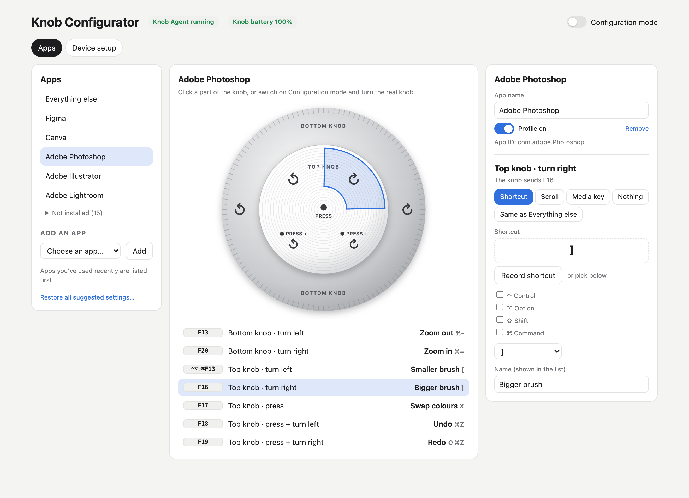
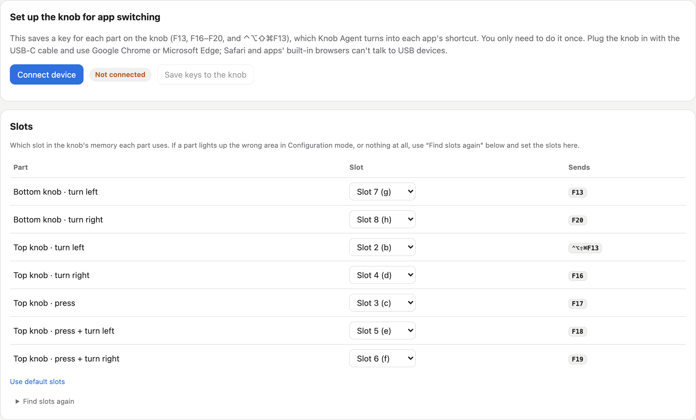
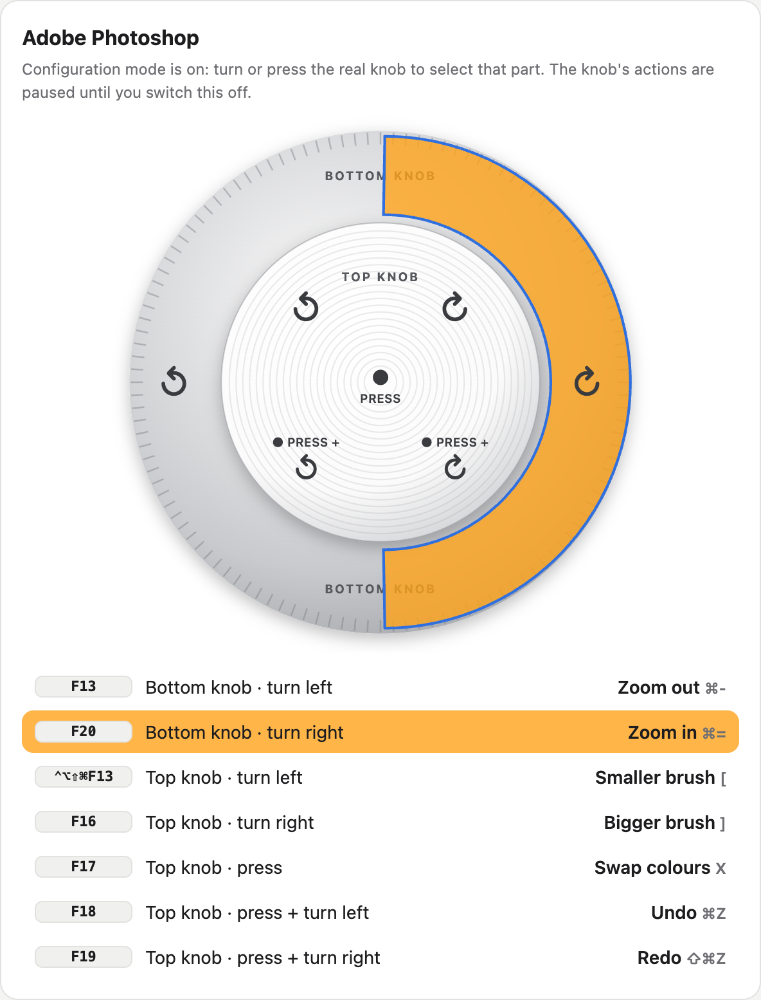

# Knob Configurator

Per-app knob actions for the two-knob aluminium "MINI_KEYBOARD" macro pad on macOS.

Turn the top knob and Photoshop changes the brush size, Figma zooms, Premiere steps a frame. Everywhere else it changes the volume. Everything is set from a page in your browser, with a drawing of the knob instead of a list of key codes, and nothing leaves your Mac.



## What's in it

- **Knob Agent**: a small menu-bar app. It catches the knob's keys and sends the shortcut that the app in front needs.
- **The configurator page**, served by Knob Agent at <http://127.0.0.1:8850>:
  - **Apps**: choose what each part of the knob does in each app. Click a part of the drawing, or switch on *Configuration mode* and turn the real knob to select it.
  - **Device setup**: saves the knob's keys to the device itself over USB (Chrome or Edge).
- **Ready-made profiles** for 20 apps (listed below), plus an *Everything else* profile for every other app. Add any other app in two clicks.
- **Battery level** of the knob in the menu and on the page, with a warning when it runs low.

## The device

This is made for the two-knob pad sold under many names on AliExpress, Amazon and similar shops, usually with a "Double-layer Knob Custom Keyboard" user guide. It shows up as:

| | |
|---|---|
| Bluetooth name | `MINI_KEYBOARD` |
| USB ID | `514c:8850` ("USB Composite Device") |
| Connections | USB-C, Bluetooth 5.0, 2.4 GHz receiver |

The maker's software runs only on Windows. This project replaces it on macOS.

The knob has seven parts. Each one is set up to send a key that no normal keyboard has:

| Part | Key | Slot in the knob's memory |
|---|---|---|
| Bottom knob, turn left | F13 | 7 |
| Bottom knob, turn right | F20 | 8 |
| Top knob, turn left | ⌃⌥⇧⌘F13 (Control-Option-Shift-Command-F13) | 2 |
| Top knob, turn right | F16 | 4 |
| Top knob, press | F17 | 3 |
| Top knob, press and turn left | F18 | 5 |
| Top knob, press and turn right | F19 | 6 |

Knob Agent turns those keys into each app's shortcut. Because no normal keyboard sends them, your other keyboards are never touched.

F14 and F15 are skipped on purpose: macOS turns them into screen-brightness keys before any app can see them. That leaves six spare F-keys for seven parts, so the top knob's left turn sends F13 with all four modifiers held.

## Install

1. Download `KnobAgent-<version>.dmg` from the [latest release](https://github.com/itsdamiro/knob-configurator/releases/latest).
2. Open it and drag **Knob Agent** into **Applications**.
3. Open **Knob Agent**. The first time, macOS blocks it because it isn't from an identified developer. Open **System Settings → Privacy & Security**, scroll down and click **Open Anyway** next to the message about Knob Agent, then confirm. You only need to do this once.
4. Allow it to read the knob: open **System Settings → Device Control and Data Access → Accessibility** (on older macOS: **Privacy & Security → Accessibility**), and switch on **Knob Agent**. If it isn't listed, click **+** and choose it from Applications. Allow **Input Monitoring** too if macOS asks.
5. A dial icon appears in the menu bar. Choose **Open configurator…**, or go to <http://127.0.0.1:8850>.

Requires macOS 13 or later, on Apple Silicon or Intel.

### Set up the knob (once)

The knob has to be told to send the keys in the table above. This is saved on the knob itself, so it keeps working over Bluetooth and on other computers.

1. Connect the knob with a USB-C cable.
2. Open <http://127.0.0.1:8850> in **Google Chrome** or **Microsoft Edge**. Safari, and apps' built-in browsers, can't talk to USB devices.
3. Go to **Device setup**, click **Connect device**, and pick "USB Composite Device".
4. Click **Save keys to the knob**.
5. Check it: switch on **Configuration mode** and turn the knob. The matching part of the drawing lights up.



The page starts with the slots in the table above, as found on a real knob. If a part lights up the wrong area, or nothing at all, your knob may use other slots: open **Find slots again** on the same tab. It gives each of the knob's 25 memory slots its own letter, so you can see which slot each part uses. Then set the slots in the table and save the keys again. **Use default slots** puts the table back to the values above.

## Using it

- **Pick an app** on the left. *Everything else* covers every app without a profile of its own. Apps you don't have installed are listed under *Not installed* and switch on by themselves when you install them.
- **Pick a part** by clicking the drawing or the list under it, or switch on **Configuration mode** and turn or press the real knob. While Configuration mode is on, the knob only selects parts on the page; it switches off when you leave the page.

  

- **Choose an action**:
  - **Shortcut**: click **Record shortcut** and press the keys, or pick them below.
  - **Scroll**: up, down, left or right, and how many lines per click.
  - **Media key**: volume, mute, play/pause, next/previous track, screen brightness.
  - **Nothing**, or **Same as Everything else**.
- **Changes save straight away.** There is no Save button.
- **Add an app** from the list of recently used and installed apps.
- **Restore all suggested settings** puts every profile back to the defaults below.

The menu-bar icon also has **Pause**, **Open at login** and **Quit**.

### Battery

While the knob is connected over Bluetooth, Knob Agent shows its battery level in the menu and in the page header. It checks every 5 minutes and whenever you open the menu. At 20% or less, the percentage also appears next to the dial icon in the menu bar, and macOS shows a notification at 20% and again at 10%. The first time, macOS asks whether Knob Agent may send notifications.

The maker rates the battery at about a week of use with the lights off, and 3–4 hours with them on.

### Lights

Knob Configurator can't change the knob's lights yet. The light commands known from related pads (the 0x8840/0x8842 and 0x8890 models) were tested on this model and have no effect, so its light command is still unknown. Working it out needs a USB capture of the maker's Windows app changing the lights. If you can make one, please open an issue.

## Ready-made profiles

These are suggestions, and every one can be changed on the page.

| App | Top knob turn | Top knob press | Bottom knob turn | Press and turn |
|---|---|---|---|---|
| Everything else | Volume down / up | Mute | Scroll up / down | Previous / next track |
| Figma | Zoom out / in (⌘− / ⌘=) | Zoom to fit (⇧1) | Scroll | Previous / next layer (⇧⇥ / ⇥) |
| Framer | Zoom out / in | Zoom to fit (⇧1) | Scroll | Undo / redo |
| Sketch | Zoom out / in | Zoom to fit (⌘1) | Scroll | Previous / next layer |
| Canva | Zoom out / in | Nothing | Scroll | Undo / redo |
| Adobe Photoshop | Brush smaller / bigger ([ / ]) | Swap colours (X) | Zoom out / in | Undo / redo |
| Adobe Illustrator | Zoom out / in | Fit artboard (⌘0) | Scroll | Undo / redo |
| Adobe InDesign | Zoom out / in | Fit page (⌘0) | Scroll | Previous / next page |
| Adobe Lightroom (and Classic) | Previous / next photo | Toggle zoom (Z) | Zoom out / in | Undo / redo |
| Adobe Acrobat | Zoom out / in | Fit page (⌘0) | Scroll | Previous / next page |
| Adobe Premiere Pro | Back / forward one frame | Play / pause | Timeline zoom (− / =) | Previous / next edit (↑ / ↓) |
| Adobe After Effects | Back / forward one frame | Play / pause | Timeline zoom (− / =) | Previous / next keyframe (J / K) |
| Adobe Audition | Zoom out / in | Play / pause | Scroll | Undo / redo |
| Affinity Photo | Brush smaller / bigger | Swap colours (X) | Zoom out / in | Undo / redo |
| Affinity Designer | Zoom out / in | Zoom to fit (⌘0) | Scroll | Undo / redo |
| Affinity Publisher | Zoom out / in | Zoom to fit (⌘0) | Scroll | Previous / next page |
| Affinity (2025) | Zoom out / in | Zoom to fit (⌘0) | Scroll | Undo / redo |
| Pixelmator Pro | Brush smaller / bigger | Zoom to fit (⌘0) | Zoom out / in | Undo / redo |
| CapCut | Back / forward one frame | Play / pause | Timeline zoom (⌘− / ⌘=) | Undo / redo |
| Final Cut Pro | Back / forward one frame | Play / pause | Timeline zoom (⌘− / ⌘=) | Previous / next edit |
| DaVinci Resolve | Back / forward one frame | Play / pause | Timeline zoom (⌘− / ⌘=) | Previous / next edit |

Apps are recognised by their bundle ID, matched from the start, so `com.adobe.PremierePro` covers every Premiere version. The defaults assume each app's standard shortcuts on a US keyboard layout. If you changed an app's shortcuts, change the knob to match.

## Troubleshooting

| What happens | What to do |
|---|---|
| macOS says Knob Agent "can't be opened" | Use **Open Anyway** in Privacy & Security (Install, step 3). |
| The page shows "Knob Agent needs permission" | Switch Knob Agent on under Accessibility (Install, step 4). If it's already on, remove it with **–**, add it again with **+**, and reload the page. macOS ties the permission to the exact app build, so this is also needed after every update. |
| The page shows "Knob Agent isn't running" | Open Knob Agent from Applications. |
| The menu says port 8850 is busy | Something else is using that address. Quit it; Knob Agent keeps retrying and starts the page on its own. |
| Connect device does nothing | Use Google Chrome or Microsoft Edge, not Safari or an app's built-in browser. |
| Turning the knob changes the screen brightness | The knob still has the keys from version 1.0, which used F14 and F15; macOS treats those as brightness keys. Click **Save keys to the knob** on the Device setup tab. |
| The battery shows "—" | The level is only reported over Bluetooth. Over the USB cable, or with the 2.4 GHz receiver, it isn't available. |
| No low-battery notification | Allow notifications for Knob Agent in System Settings → Notifications. |
| A shortcut does the wrong thing in an app | Check the app's own shortcut, then change it on the page. Keyboard layouts other than US can move keys such as `[`, `]`, `-` and `=`. |

## Build from source

You need macOS 13 or later and Apple's command line tools (`xcode-select --install`). There are no other dependencies.

```sh
./build.sh           # builds "build/Knob Agent.app" (universal: Apple Silicon and Intel)
./build.sh install   # also copies it to ~/Applications and opens it
./build.sh dmg       # also packages dist/KnobAgent-<version>.dmg
```

| Path | What it is |
|---|---|
| `agent/main.swift` | Knob Agent: the key catcher, per-app actions, the local page server and the menu-bar icon. |
| `agent/Info.plist` | App name, bundle ID (`io.github.itsdamiro.knob-agent`) and version. |
| `web/index.html` | The configurator page, one file with no dependencies. |
| `web/presets.json` | The ready-made profiles. |

Your settings are stored in `~/Library/Application Support/Knob Agent/config.json`.

## How it works

- **Catching the knob.** Knob Agent installs a macOS event tap. It removes the knob's key presses (F13, F16–F20 and ⌃⌥⇧⌘F13) before any app sees them, and lets every other key through untouched.
- **Sending the action.** It looks up the app in front, finds its profile (or *Everything else*), and posts the shortcut, scroll or media key as new events.
- **Battery.** It reads the level macOS gets over Bluetooth, from `system_profiler SPBluetoothDataType`. Over Bluetooth the knob presents itself as `MINI_KEYBOARD`, with vendor ID 0x05AC and product ID 0x022C.
- **The page.** Knob Agent serves the page and a small JSON API on `127.0.0.1:8850`. The page saves changes there and gets live events, knob turns and app switches, over a server-sent event stream. That's how Configuration mode lights up the drawing.
- **The device.** The page writes key settings to the knob over WebHID, through the knob's vendor-defined HID interface (usage page `0xFF00`, report ID 3, 64-byte reports). The message format comes from the open-source [ch57x-keyboard-tool](https://github.com/kriomant/ch57x-keyboard-tool), whose `k8850_4x4` driver covers this USB ID.

## Privacy and security

- Knob Agent reacts only to the knob's keys (F13, F16–F20 and ⌃⌥⇧⌘F13). It doesn't record, store or send any other keys.
- From the Bluetooth device list it reads only the knob's battery level, and keeps nothing.
- Nothing is sent over the internet. The page server listens on `127.0.0.1` only.
- The server answers only requests addressed to `127.0.0.1:8850` or `localhost:8850`, which blocks DNS-rebinding tricks. It accepts changes only from its own page: the request must come from that origin and send JSON, so other websites can't change your settings.
- The app is signed ad hoc, not with an Apple Developer ID, which is why macOS asks you to approve it on first launch.

## Credits

- The device protocol comes from [ch57x-keyboard-tool](https://github.com/kriomant/ch57x-keyboard-tool) by Mikhail Trishchenkov (MIT licence).
- Not affiliated with the maker of the device, Adobe, Figma, Serif, Canva, Apple or any other company named here. All names are trademarks of their owners.

## Licence

[MIT](LICENSE)
